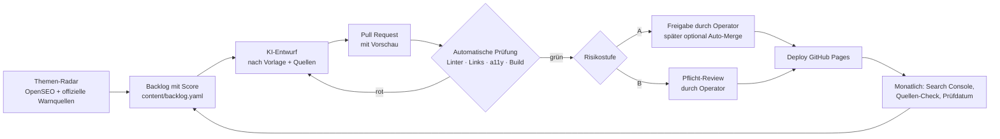

# Recherche und Autonomieplan Senioren-Hilfe Online (Stand 27.10.2026)

> **Einordnung:** Dieses Dokument ist ein Vorschlag zur Entscheidung durch den Human Operator. Es ändert keinen Status in `RELEASE_STATE_V1.yaml`, `WORK_QUEUE_V1.yaml` oder dem Batch-Manifest und setzt keine Publish Readiness, keine Launch- oder Monetarisierungsfreigabe.
>
> **Datenbasis:** OpenSEO-Abrufe vom 27.10.2026, Markt Deutschland, Sprache Deutsch. Rohdaten: [`docs/content/seo/openseo_snapshots/`](../content/seo/openseo_snapshots/README.md).

## 1. Kurzfassung

1. **Das Ziel ist richtig, der Betrieb ist blockiert.** Mission, Trust-Regeln und Tonalität sind stark. Aber das Repo hat in 5 Wochen ca. 236.000 Wörter Prozessdokumentation erzeugt und genau **einen** öffentlichen Artikel (ca. 480 Wörter). Seit dem 16.07.2026 gibt es keine Commits mehr.
2. **Die Nachfrage ist da und für eine kleine, gute Seite erreichbar.** Viele seniorenrelevante Bedienfragen haben hohes Suchvolumen bei sehr niedriger Keyword-Difficulty (KD 0–5), z. B. „mailbox abhören“ (12.100/Monat, KD 1), „whatsapp kontakt löschen“ (14.800, KD 2), „neues handy einrichten“ (5.400, KD 0), „quishing“ (4.400, KD 1).
3. **Die Seniorennische ist schwach besetzt.** Für „smartphone anleitung für senioren kostenlos“ ranken ein AWO-PDF, YouTube-Videos und Shopseiten (C&A, Alza). Das passt exakt zum geplanten USP „druckbare Checklisten“.
4. **Betrugs-Hauptbegriffe sind schwer.** „betrug whatsapp“, „enkeltrick“, „ki betrug“ werden von NDR, SWR, Tagesschau, Polizei und Banken dominiert. Dort gewinnt man über Long-Tail, Angehörigen-Checklisten und Druckversionen, nicht über den Kopfbegriff.
5. **In 12 von 13 geprüften Suchergebnissen erscheint eine Google-KI-Übersicht.** Reine Kurzantworten werden kaum noch geklickt. Mehrwert müssen druckbare Anleitungen, Angehörigen-Teile und echte Schritt-für-Schritt-Hilfe liefern.
6. **Autonomer Betrieb ist machbar**, wenn (a) die Governance von „Dokument je Entscheidung“ auf „Risikostufe je Artikel“ umgestellt wird, (b) Inhalte als Markdown mit Pflichtfeldern gepflegt und automatisch geprüft werden und (c) ein wöchentlicher KI-Arbeitszyklus Entwürfe als Pull Request liefert, die Sie in ca. 10–20 Minuten freigeben.

## 2. Methodik und Datenbasis

| Schritt | Werkzeug | Umfang | Credits |
| --- | --- | --- | --- |
| Keyword-Metriken | `get_keyword_metrics` (2 Abrufe) | 212 Begriffe mit Daten | ca. 60 |
| Long-Tail-Ideen | `research_keywords` | Seeds „smartphone senioren“, „whatsapp betrug“ (280 Ideen, 30 relevante übernommen) | ca. 100 |
| Wettbewerb | `get_serp_results` | 13 Begriffe, Google Desktop DE | ca. 55 |
| **Summe** | | | **214** (331 → 117) |

**Grenzen (bitte beachten):**

- Suchvolumen sind Google-Ads-Schätzungen (Monatsdurchschnitt). Sie sind keine Traffic-Prognose.
- KD ist ein Schätzwert von DataForSEO (0–100) und keine Ranking-Garantie.
- Summen verwandter Begriffe überlappen und sind nur als Größenordnung zu lesen.
- Für einige Begriffe lieferte die Datenbank keine Werte, darunter „whatsapp betrug“ und „hallo mama betrug“. Liste siehe Snapshot-README.
- Eigene Search-Console-Daten fehlen, weil die Seite per `robots.txt` und `noindex` gesperrt ist.

## 3. Repo-Analyse

### 3.1 Fakten

| Kennzahl | Wert | Quelle |
| --- | --- | --- |
| Commits | 53, vom 12.06. bis 16.07.2026 | `git log` |
| Markdown-Dokumente unter `docs/` | 255, ca. 236.000 Wörter | `find docs -name '*.md' \| xargs wc -w` |
| Operator-Entscheidungsdokumente | 26 | `docs/operations/operator_decisions/` |
| Artikel-Review-Dokumente | 45 | `docs/content/article_reviews/` |
| `scripts/validate_content_contracts.py` | 24.046 Zeilen, 111 Funktionen | `wc -l`, `grep -c "def "` |
| Öffentliche Artikel | 1 (`/artikel/whatsapp-betrug-checkliste/`, ca. 480 Wörter inkl. Navigation) | `public_site/` |
| Indexierung | gesperrt (`Disallow: /` und `noindex, nofollow`) | `public_site/robots.txt`, HTML-Meta |
| Search Console, Analytics | nicht verbunden | `RELEASE_STATE_V1.yaml` |
| Domain | `netzleicht.de` (Seitentitel: „Senioren-Hilfe Online“) | `RELEASE_STATE_V1.yaml`, `public_site/index.html` |
| Offene Blocker | `SHO-CLAIM-007` (WhatsApp Blockieren/Melden), `SHO-SRC-004`, fehlende Screenshots für Brief 003 | `RELEASE_STATE_V1.yaml`, `WORK_QUEUE_V1.yaml` |

### 3.2 Bewertung

**Behalten (Stärken):**

- Klare Mission und Zielgruppen (Senior:innen und Angehörige).
- Trust-first-Regeln: keine Affiliate-Links bei Sicherheitsthemen, keine Angst-Monetarisierung (`docs/governance/TRUST_AND_MONETIZATION_POLICY.md`, `docs/strategy/MONETIZATION_THESIS.md`).
- Quellenstandard mit offiziellen Quellen wie Polizei, Verbraucherzentrale und BSI.
- Senior-UX-Standard; das CSS nutzt bereits 18px Grundschrift und Zeilenhöhe 1,65.
- Der veröffentlichte Artikel ist inhaltlich gut: ruhig, konkret und mit Druck-Checkliste.
- Schlankes Hosting über GitHub Pages mit CI-Prüfung.

**Ändern (Ursachen der Blockade):**

1. **Das Verhältnis von Prozess zu Ergebnis kippt.** Auf jedes veröffentlichte Wort kommen ca. 490 Wörter Governance. Jede Mikroentscheidung erzeugt ein Decision-Packet, ein Review und eine Validator-Erweiterung. Der Validator wächst mit jedem Schritt. Das ist das Gegenteil von Autonomie, denn jede Änderung braucht wieder Sonderregeln.
2. **Blocker sind selbst erzeugt.** Brief 003 (Schriftgröße) wartet auf eigene Screenshots, und WhatsApp Blockieren/Melden ist gesperrt. Beides lässt sich mit offiziellen Hersteller-Hilfeseiten (Apple, Google, Samsung, WhatsApp-Hilfecenter) als Quelle, einem Prüfdatum und einer Versionsangabe lösen. Die Daten zeigen dafür echte Nachfrage, z. B. „whatsapp kontakt blockieren“ mit 2.400/Monat.
3. **Interne Prozesssprache steht im Lesertext.** Im Artikel steht: „Es gibt keine finale Freshness-Freigabe.“ Das verunsichert Senior:innen und gehört ins Repo, nicht auf die Seite.
4. **Es fehlt eine Datenrückkopplung.** Die Lernschleife (`METRICS_AND_LEARNING_LOOP.md`) existiert nur auf Papier, solange die Seite nicht indexiert ist.
5. **Die Seiten werden von Hand gebaut.** HTML wird ohne Generator und ohne Vorlage geschrieben. Jeder Artikel ist dadurch Handarbeit, und die Übersichtsseiten pflegen sich nicht selbst.
6. **Die Marke ist uneinheitlich.** Die Domain heißt `netzleicht.de`, der Seitentitel „Senioren-Hilfe Online“. Für Vertrauen und Wiedererkennung sollte das eine Entscheidung sein.

## 4. Recherche-Ergebnisse

### 4.1 Wettbewerb in den Suchergebnissen

| Muster | Beobachtung | Folgerung |
| --- | --- | --- |
| Google-KI-Übersicht | in 12 von 13 SERPs | Kurzantworten verlieren Klicks; Mehrwert über Druck-PDF, Angehörigen-Teil und Schrittfolgen |
| Seniorennische | „whatsapp für senioren“, „schrift vergrößern handy“, „smartphone anleitung für senioren kostenlos“: kleine Seiten, Vereins-PDFs, YouTube, Shops | **gewinnbar** mit wirklich seniorengerechter Qualität |
| Betrugs-Kopfbegriffe | NDR, SWR, Tagesschau, Polizei, Postbank, Verbraucherzentrale; zusätzlich „Top Stories“ | Kopfbegriff schwer; Long-Tail und Checklisten für Familien |
| Bedienfragen | Hersteller, Provider, Händler, Tech-Portale (chip, giga, netzwelt), gutefrage | mittel gewinnbar; der Seniorenblick ist das Unterscheidungsmerkmal |
| YouTube / Video | YouTube in den organischen Top 10 bei 5 von 13 SERPs; Video-Box bei 8 von 13; zusammen 9 von 13 | Video ist für die Zielgruppe relevant (spätere Ausbaustufe) |
| „pushtan“ | ausschließlich Sparkassen-Seiten | nicht angehen (navigationale Suche) |

### 4.2 Priorisierte Themen

**Bewertungslogik (transparent):** Mission-Fit, also ein echtes Alltagsproblem der Zielgruppe, ist Pflicht. Danach zählen Nachfrage (Summe der Einzelvolumina, überlappend), Gewinnbarkeit (KD plus SERP-Typ) und Risiko. Die Risikostufe bestimmt die Freigabeart (siehe Abschnitt 5.2).

**Welle 1: Smartphone-Grundlagen (Risikostufe A)**

| # | Arbeitstitel | Haupt-Keyword (SV, KD) | Σ Cluster-SV | SERP-Einschätzung |
| --- | --- | --- | --- | --- |
| 1 | Smartphone-Anleitung für Senioren – kostenlos zum Ausdrucken (Hub) | smartphone anleitung für senioren kostenlos (590, 7) | ~1.240 | schwach besetzt (AWO-PDF, YouTube, Shops) |
| 2 | Schrift größer stellen und einfacher Modus (Android, iPhone, Samsung) | schriftgröße ändern android (590, 0) | ~2.460 | kleine Seiten, YouTube; vorhandener Brief 003 |
| 3 | Neues Handy einrichten – Checkliste für Senioren und Angehörige | neues handy einrichten (5.400, 0) | ~12.280 | Hersteller und Provider; Seniorenblick fehlt |
| 4 | WhatsApp-Chats aufs neue Handy übertragen und sichern | whatsapp auf neues handy übertragen (8.100, 0) | ~47.000 | copytrans, giga, gutefrage: gewinnbar |
| 5 | Mailbox abhören (Telekom, Vodafone, O2, Discounter) | mailbox abhören (12.100, 1) | ~12.100 | Quelle: Hilfeseiten der Netzbetreiber |
| 6 | Die wichtigsten Handgriffe: Neustart, Bildschirm drehen, Taschenlampe, Screenshot | bildschirm drehen (14.800, 1) | ~33.380 | Einzelseiten oder Sammelratgeber |
| 7 | Handy-Speicher voll – was tun? | speicherplatz freigeben (8.100, 14) | ~11.380 | Tech-Portale |
| 8 | Handy mit WLAN verbinden | wlan verbinden (2.400, 0) | ~3.440 | Backlog-Thema vorhanden |
| 9 | Notfallpass und SOS-Notruf am Handy einrichten | notfallpass handy (1.300, 7) | ~2.020 | gesundheitsnah: Stufe B |
| 10 | Hörgerät mit dem Handy verbinden | hörgerät mit handy verbinden (320, 0) | ~2.220 | sehr seniorenspezifisch |

**Welle 2: WhatsApp-Bedienung (Stufe A, Quelle: offizielles WhatsApp-Hilfecenter)**

| # | Arbeitstitel | Haupt-Keyword (SV, KD) | Σ Cluster-SV |
| --- | --- | --- | --- |
| 11 | WhatsApp für Senioren – Übersicht (Hub) | whatsapp für senioren (110, 0) | ~220 (Hub für interne Verlinkung) |
| 12 | Kontakte hinzufügen, löschen und blockieren | whatsapp kontakt löschen (14.800, 2) | ~18.800 |
| 13 | Bilder senden, Profilbild, Nachrichten löschen, Gruppen | whatsapp gruppe löschen (9.900, 0) | ~32.500 |
| 14 | Videoanruf mit WhatsApp | whatsapp videoanruf (3.600, 4) | ~6.500 |
| 15 | Sprachnachricht aufnehmen und anhören | whatsapp sprachnachricht (2.900, 2) | ~2.900 |

**Welle 3: Sicherheit und Betrug (Stufe B, immer menschliche Freigabe)**

| # | Arbeitstitel | Haupt-Keyword (SV, KD) | Σ Cluster-SV | Hinweis |
| --- | --- | --- | --- | --- |
| 16 | WhatsApp-Betrug erkennen (Ausbau des bestehenden Artikels, inkl. Kontoübernahme per Code) | betrug whatsapp (6.600, 5) | ~14.770 | News-lastige SERP |
| 17 | Enkeltrick und Schockanruf – Checkliste für Familien zum Ausdrucken | enkeltrick (27.100, 9) | ~30.870 | Polizei dominiert; Familien-Checkliste als eigener Blickwinkel |
| 18 | QR-Code-Betrug (Quishing) einfach erklärt | quishing (4.400, 1) | ~4.540 | nur IT-Anbieter-Seiten: **Lücke** |
| 19 | Ping-Anrufe und unbekannte Nummern blockieren | ping anrufe (4.400, 11) | ~8.190 | |
| 20 | Betrugs-SMS erkennen (Paket, Bank, Smishing) | sms betrug (2.400, 8) | ~5.190 | |
| 21 | Drittanbietersperre einrichten | drittanbietersperre (2.900, 4) | ~2.930 | Tech-Portale, BNetzA |
| 22 | Handy gehackt oder Virus? Ruhig prüfen | virus auf dem handy (1.900, 0) | ~4.380 | |
| 23 | Phishing-Mails erkennen | phishing mail erkennen (880, 18) | ~2.420 | |
| 24 | Betrug mit KI-Stimmen | ki betrug (880, 0) | ~880 | Trendthema |

**Welle 4: Digitaler Alltag, Gesundheit und Behörden (Stufe B, höchste Quellenanforderung)**

| # | Arbeitstitel | Haupt-Keyword (SV, KD) | Σ Cluster-SV | Pflichtquellen |
| --- | --- | --- | --- | --- |
| 25 | Elektronische Patientenakte und E-Rezept-App (inkl. Widerspruch) | epa app (12.100, 28) | ~67.780 | gematik, BMG, Krankenkassen |
| 26 | Rente online beantragen | rente online beantragen (3.600, 32) | ~5.500 | Deutsche Rentenversicherung |
| 27 | Deutschlandticket für Senioren | deutschlandticket senioren (1.900, 10) | ~1.900 | Verkehrsverbünde, DB |
| 28 | Arzttermin online buchen | arzttermin online buchen (1.600, 0) | ~1.600 | Anbieter-Hilfen, KV (116117) |
| 29 | Online-Überweisung sicher machen | online überweisung (1.600, 18) | ~1.770 | Bankenverbände, BSI |

**Bewusst nicht priorisiert:**

- Gerätekauf („seniorenhandy“ 27.100, „senioren smartphone“ 5.400): Die Suche ist transaktional, die SERPs sind voller Shops und Testportale, und das Thema ist monetarisierungsnah. Später höchstens als neutrale Entscheidungshilfe ohne Produktempfehlung, wie im Backlog vorgesehen.
- Navigationale Begriffe („app store“, „google fotos“, „doctolib“, „pushtan“): Die Nutzer wollen direkt zum Anbieter.
- Saisonale Grußbilder („geburtstagswünsche kostenlos whatsapp“ 14.800): hohe Nachfrage, aber kaum Beitrag zur Mission.

## 5. Zielbild: möglichst autonomer Betrieb

### 5.1 Grundprinzip

> **Routine läuft automatisch. Wo Vertrauen auf dem Spiel steht, entscheidet ein Mensch.**

Die bestehende Trust-Policy bleibt gültig. Geändert wird nur die Art der Absicherung: Statt eines eigenen Dokuments pro Entscheidung gibt es pro Artikel eine Risikostufe, Pflichtfelder und automatische Prüfungen.

### 5.2 Risikostufen ersetzen Gate-Dokumente

| Stufe | Themen | Entwurf | Prüfung | Freigabe |
| --- | --- | --- | --- | --- |
| **A** | reine Bedienung (Schriftgröße, WLAN, Mailbox, WhatsApp-Funktionen) | KI | automatisch (Linter, Links, Barrierefreiheit) | PR-Merge durch Operator; nach z. B. 10 Artikeln ohne inhaltliche Korrektur optional Auto-Merge |
| **B** | Sicherheit, Betrug, Geld, Gesundheit, Behörden | KI | automatisch, dazu mindestens 2 offizielle Quellen als Pflicht | **immer** menschliche Freigabe |
| **C** | Rechtstexte, Monetarisierung, Kooperationen, Datenschutz, Nutzerkontakt | – | – | nur durch den Menschen, nie autonom |

### 5.3 Wöchentlicher Arbeitszyklus



| Takt | Job | Ausführung | Ergebnis |
| --- | --- | --- | --- |
| wöchentlich | Themen-Radar: Keyword-Metriken für Backlog-Kandidaten, neue Warnungen von Verbraucherzentrale (Phishing-Radar), Polizei-Beratung und BSI | Claude-Code-Aufgabe mit OpenSEO-MCP | aktualisierter Backlog mit Score |
| wöchentlich | 1–2 Artikelentwürfe nach Vorlage | Claude-Code-Aufgabe | Pull Request mit Vorschau |
| bei jedem PR | Content-Linter, Link-Check, Barrierefreiheitsprüfung (axe/Playwright), Build | GitHub Actions | grün oder rot mit konkreter Meldung |
| monatlich | Pflege: Quellen erreichbar? Prüfdatum älter als 6 Monate? Search-Console-Auswertung (keep/improve/rewrite/retire laut `METRICS_AND_LEARNING_LOOP.md`) | Claude-Code-Aufgabe | PRs mit Aktualisierungen und ein Kurzbericht |
| anlassbezogen | neue Betrugswelle (z. B. Polizei-Warnung) | Radar erkennt sie | Eilentwurf mit Stufe B (Freigabe nötig) |

**Menschlicher Aufwand (Annahme):** einmalig mehr Zeit in Phase 0, danach ca. 1–2 Stunden pro Woche für PR-Reviews.

### 5.4 Technische Umstellung (minimal-invasiv)

1. **Inhalte als Markdown mit Pflichtfeldern**, z. B. `content/artikel/<slug>.md`:

   ```yaml
   ---
   title: "Schrift auf dem Handy größer stellen"
   slug: schrift-groesser-stellen
   cluster: smartphone-grundlagen
   risikostufe: A            # A | B | C
   zielgruppe: [senioren, angehoerige]
   haupt_keyword: "schriftgröße ändern android"
   keyword_daten_stand: 2026-10-27
   geraete: [android, iphone]
   geprueft_mit: "Hersteller-Hilfeseiten, Abruf siehe Quellen"
   zuletzt_geprueft: 2026-10-27
   naechste_pruefung: 2027-04-27
   druck_checkliste: true
   quellen:
     - titel: "Schriftgröße ändern"
       herausgeber: "Google Android-Hilfe"
       url: "https://support.google.com/..."
       abgerufen: 2026-10-27
   ---
   ```

2. **Statischer Seitengenerator.** Empfehlung: Hugo (eine Programmdatei, eingebaute Sitemap und Feeds, offizielle GitHub-Pages-Anleitung). Alternative: Eleventy. Vorlagen enthalten Druckansicht, Angehörigen-Box, Quellenblock und „Zuletzt geprüft“.
3. **Den 24.000-Zeilen-Validator durch einen kleinen Content-Linter ersetzen** (Ziel: wenige hundert Zeilen). Er prüft:
   - Pflichtfelder vorhanden; `naechste_pruefung` liegt in der Zukunft.
   - Stufe B hat mindestens 2 Quellen aus einer Liste offizieller Domains (z. B. `polizei-beratung.de`, `verbraucherzentrale.de`, `bsi.bund.de`, `support.apple.com`, `support.google.com`, `faq.whatsapp.com`).
   - Lesbarkeit: durchschnittliche Satzlänge, Liste zu erklärender Fachbegriffe.
   - Verbotene Muster: Druck- und Angstformulierungen, Heilsversprechen, Affiliate-Links in Sicherheitsartikeln.
   - Bis zum Launch bleibt die vorhandene `noindex`/`robots`-Wache aktiv.
4. **Prozessdokumente archivieren statt löschen.** Ordner wie `operator_decisions/`, `article_reviews/`, `source_metadata_citation_follow_up/` und `android_evidence_preparation/` wandern nach `archive/2026-mvp-governance/`. Die Git-Historie bleibt vollständig. Weiter gelten vier kurze Kerndokumente: Trust und Monetarisierung, Quellenstandard, Senior-UX-Standard und Redaktions-Checkliste.
5. **Das Screenshot-Problem pragmatisch lösen:**
   - Schritte mit exakten Menünamen aus offiziellen Hilfeseiten, dazu Prüfdatum und Geräteangabe.
   - Statt Fotos eigene schematische Grafiken (SVG); das ist rechtlich unkritisch und leicht zu aktualisieren.
   - Später eigene Screenshots von je einem Referenzgerät (Android, iPhone).

### 5.5 Reichweite jenseits von Google

Weil KI-Übersichten Klicks abziehen, sollte die Seite nicht nur von der Google-Suche abhängen:

- **Druck-PDFs** pro Anleitung (A4, große Schrift). Auf genau diese Suchabsicht („…pdf“, „…kostenlos“) gibt es messbare Nachfrage.
- **Weitergabe über Multiplikatoren:** Seniorenbüros, VHS, AWO-Cafés und Digital-Kompass-Standorte („digital kompass“ hat 1.600 Suchen/Monat). Sie ranken bereits mit Kurs-PDFs und brauchen Material.
- **Später** ein Newsletter „Betrugswarnung des Monats“. Dafür ist eine eigene Datenschutz-Entscheidung nötig (Stufe C, Double-Opt-in).

## 6. Phasenplan

| Phase | Zeitraum (Vorschlag) | Inhalt | Wer |
| --- | --- | --- | --- |
| 0 | Woche 1–2 | Entscheidungen aus Abschnitt 7; Archivierung; Generator und Linter; interne Prozesssprache aus dem Artikel entfernen | Operator entscheidet, KI setzt um |
| 1 | Woche 3–8 | Welle 1 (Artikel 1–10) inkl. Druck-PDFs; Rechtstexte geprüft → `noindex` entfernen → Search Console verbinden → Sitemap einreichen | KI-Entwürfe, Operator-Freigabe |
| 2 | Monat 3–4 | Welle 2 (WhatsApp) und Welle 3 (Sicherheit); monatlicher Pflege-Job aktiv; erste Search-Console-Daten auswerten | weitgehend autonom, Stufe-B-Reviews |
| 3 | ab Monat 5 | datengetriebene Fortsetzung (Search-Console-Chancen), Welle 4, Multiplikatoren-Kontakt, ggf. Newsletter | autonom, Operator für B/C |

Bewusst ohne Traffic- oder Umsatzprognose (siehe `METRICS_AND_LEARNING_LOOP.md`: keine erfundenen Zielwerte).

## 7. Offene Entscheidungen für den Human Operator

1. **Governance:** Sollen Risikostufen A/B/C plus Content-Linter die bisherigen Gate-Dokumente ersetzen und die Altdokumente archiviert werden?
2. **Marke:** „Senioren-Hilfe Online“ oder „netzleicht“? Eine einheitliche Marke für Domain, Logo und Seitentitel.
3. **Rechtstexte:** Wer prüft Impressum und Datenschutz extern? Das ist die Voraussetzung für die Indexierung.
4. **Launch:** Indexierung freigeben, sobald Welle 1 mit mindestens 5 Artikeln steht?
5. **Messung:** Nur Search Console (kein Tracking auf der Seite) oder zusätzlich eine cookielose Statistik?
6. **Werkzeuge und Budget:** Wo laufen die Arbeitszyklen (geplante Claude-Code-Aufgaben oder GitHub Actions mit API-Schlüssel)? Wie viele OpenSEO-Credits pro Monat? Gemessener Richtwert: ca. 30 Credits pro 100 Keyword-Metriken, ca. 5 pro SERP-Abfrage, ca. 50 pro Recherche-Seed.

## 8. Was prüfen, wenn es nicht klappt

| Symptom | Prüfen |
| --- | --- |
| Nach dem Launch keine Impressionen in der Search Console | Sind `robots.txt` und `noindex` wirklich entfernt (Live-Abruf, nicht nur im Repo)? Ist die Sitemap eingereicht? Zeigt die URL-Prüfung „indexiert“? |
| Artikel indexiert, aber kein Ranking | Passt der Inhalt zur Suchabsicht (SERP erneut ansehen)? Wird das Haupt-Keyword in Titel und H1 genutzt? Gibt es interne Links vom Hub? |
| KI-Entwurf fachlich falsch | Stimmen die Quellen mit den Schritten überein? Ist die Gerätegeneration angegeben? Stufe prüfen (eventuell B statt A) |
| CI rot | Linter-Meldung lesen: fehlendes Pflichtfeld, Quellen-Domain nicht auf der Liste oder kaputter Link |
| OpenSEO-Abruf schlägt fehl | Credits prüfen (`whoami`); bei leerem Konto die Abrufe reduzieren (Metriken statt Recherche-Seeds) |

## 9. Reproduzierbarkeit

- **OpenSEO-Projekt:** „Senioren-Hilfe Online (netzleicht.de)“, Markt 2276/`de`. Es wurde keine wiederkehrende, kostenpflichtige Überwachung eingerichtet.
- **Rohdaten:** `docs/content/seo/openseo_snapshots/2026-10-27_keyword_metrics_de.csv` und `2026-10-27_serp_top10_de_desktop.csv`.
- **Repo-Kennzahlen:** mit den in Abschnitt 3.1 genannten Befehlen auf Commit `d8ed40c` erhoben.
